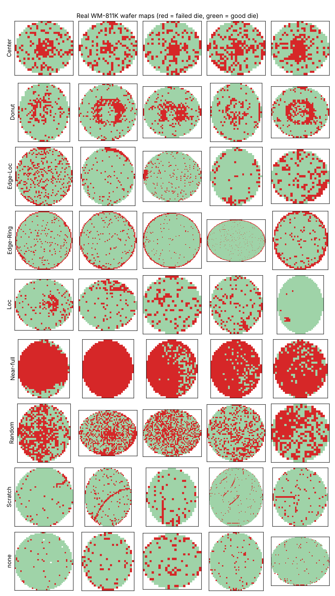
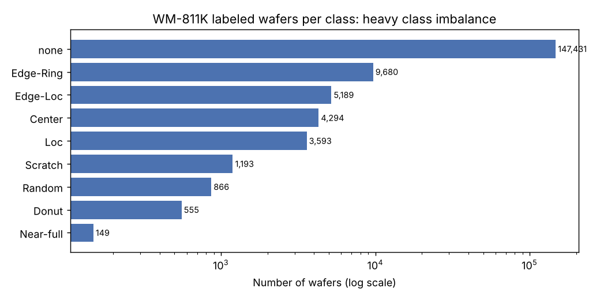
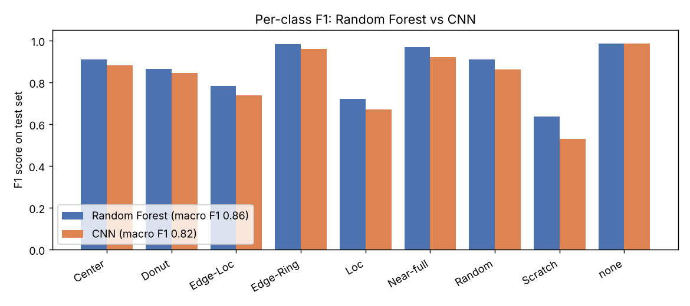
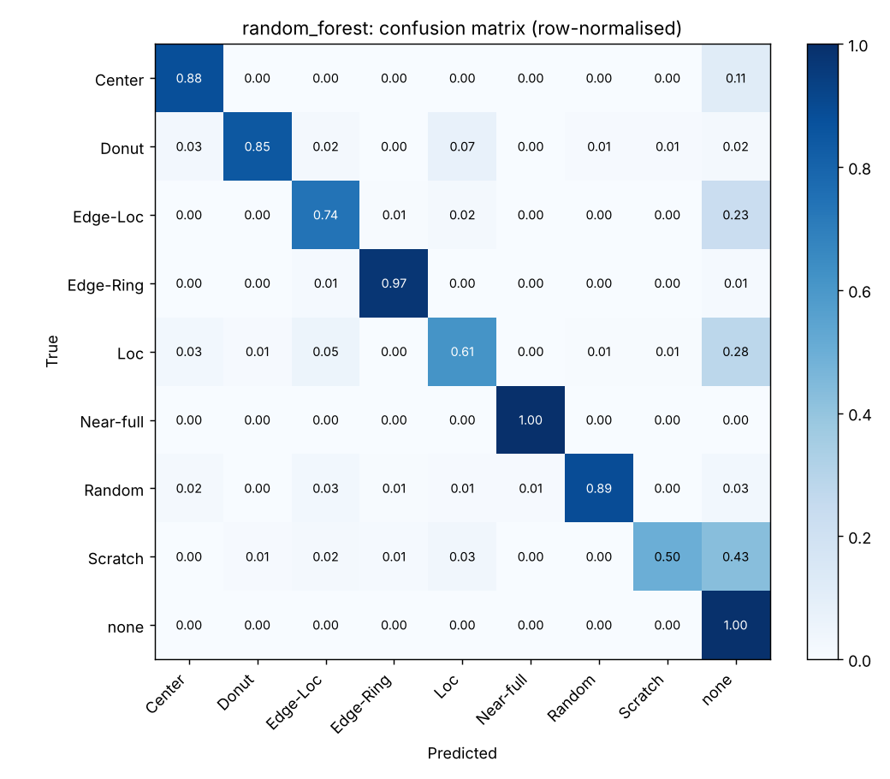
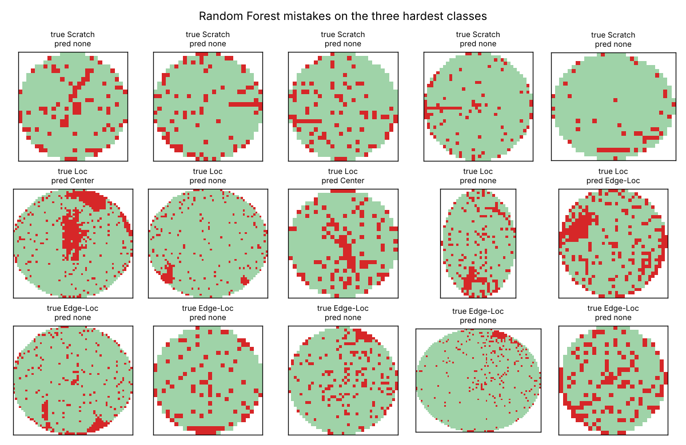
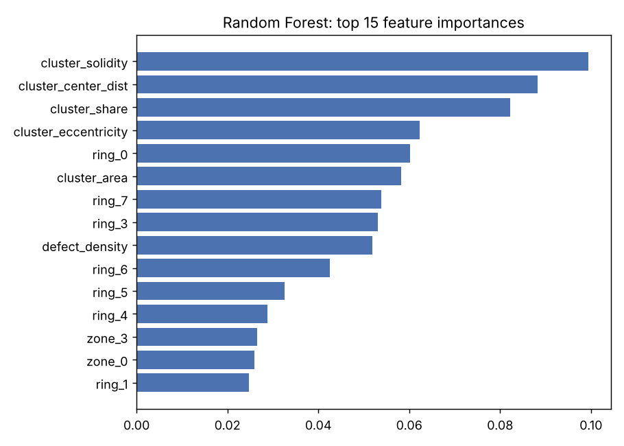

# Wafer Map Defect Pattern Classification (WM-811K)

Classifies the defect pattern on a semiconductor wafer map (Center, Donut, Edge-Loc, Edge-Ring, Loc, Near-full, Random, Scratch, or none) using **real fab data** from the WM-811K dataset.

Two approaches are compared:
1. **Random Forest** on 28 hand-crafted features (zone fail rates, radial profile, shape of the biggest failure cluster)
2. **CNN** (PyTorch) that learns directly from the wafer map as a 32×32 image



## Why this matters
After a wafer is made, every die (chip) on it is electrically tested and marked pass or fail. The **wafer map** shows where the failed dies are. The *shape* of the failures points to the cause: a ring at the edge suggests an etch or temperature problem, a thin line suggests a mechanical scratch, a blob in the center suggests a deposition or CMP issue. Classifying these patterns automatically helps engineers find root causes faster and improve **yield**.

## Dataset
- **WM-811K** (Wu et al., 2015): 811,457 wafer maps from real production, on [Kaggle](https://www.kaggle.com/datasets/qingyi/wm811k-wafer-map).
- 172,950 wafers are labeled. Each map is a 2D array: `0` = no die, `1` = good die, `2` = failed die. Map sizes range from 15×3 to 212×204.
- **Heavy class imbalance:** 85% of labeled wafers are `none`; `Near-full` has only 149 examples.



## Method
| Step | What was done |
|---|---|
| Safe loading | The original pickle is loaded with a restricted unpickler that only allows the pandas/numpy classes it needs |
| Train/test split | 80/20 **split by lot** (`StratifiedGroupKFold`): wafers from the same lot are very similar, so keeping a lot on one side avoids data leakage |
| Features (RF) | Overall defect density, fail rate in 13 wafer zones, 8-ring radial profile, and size / eccentricity / solidity / position of the largest failure cluster |
| Imbalance (RF) | `class_weight="balanced_subsample"` |
| CNN input | Map resized to 32×32 with nearest-neighbour sampling, 2 channels (die mask, fail mask) |
| CNN model | 3 conv blocks (32→64→128 filters) + global average pooling + dropout, ~290K parameters |
| Imbalance (CNN) | `none` undersampled to 20K for training, class-weighted cross-entropy, flip/rotation augmentation |
| Evaluation | Per-class precision / recall / F1 and macro F1 on 34,585 test wafers from unseen lots |

## Results (test set, unseen lots)

| Model | Accuracy | Macro F1 (all 9 classes) | Macro F1 (8 defect classes) |
|---|---|---|---|
| **Random Forest + features** | **97.1%** | **0.862** | **0.847** |
| CNN (32×32) | 96.4% | 0.821 | 0.801 |

Accuracy looks high for both only because 85% of wafers are `none`. **Macro F1** treats every class equally, so it is the fair metric here.



**Random Forest confusion matrix**



### What the results show
- **Easy classes:** Edge-Ring (F1 0.98), Near-full (0.97), Random (0.91) and Center (0.91) have clear, distinct shapes.
- **Hard classes:** Scratch (0.64), Loc (0.72) and Edge-Loc (0.78). Most of their errors are predicted as `none`. These are small, faint patterns, and many look like normal wafers with a few extra failed dies (see below).
- **Random Forest beat the CNN.** Shrinking maps to 32×32 erases thin scratch lines (CNN Scratch F1 0.53). The cluster-shape features keep that information. They also make the model easy to explain to an engineer.
- **Most important features:** cluster solidity, cluster distance from the center, and the share of failures in the biggest cluster.





## Project structure
```
src/
  download_data.py   # downloads LSWMD.pkl from Kaggle
  prepare_data.py    # safe loading, keeps labeled wafers -> data/wm811k_labeled.npz
  data.py            # loading, split by lot, resizing
  features.py        # hand-crafted features
  explore.py         # EDA plots
  train_rf.py        # Random Forest
  train_cnn.py       # CNN in PyTorch
  evaluate.py        # metrics + confusion matrix
  analyze_errors.py  # model comparison + misclassified examples
results/             # all plots, metrics and the training log
models/wafer_cnn.pt  # trained CNN weights
```

## How to run
```bash
pip install -r requirements.txt
python src/download_data.py     # LSWMD.pkl is about 2 GB
python src/prepare_data.py      # needs ~8 GB RAM to load the full pickle once
python src/explore.py
python src/train_rf.py          # ~5 min on a laptop CPU
python src/train_cnn.py         # ~20 min on CPU (much faster on a GPU)
python src/analyze_errors.py
```

## Possible improvements
- Use a higher input resolution (e.g. 64×64) or a pretrained CNN to keep thin scratch lines
- Add Radon-transform features, which are good at detecting lines
- Use the ~640K unlabeled wafers with semi-supervised learning

## Reference
M.-J. Wu, J.-S. R. Jang, J.-L. Chen, "Wafer Map Failure Pattern Recognition and Similarity Ranking for Large-Scale Data Sets," *IEEE Transactions on Semiconductor Manufacturing*, 2015.
